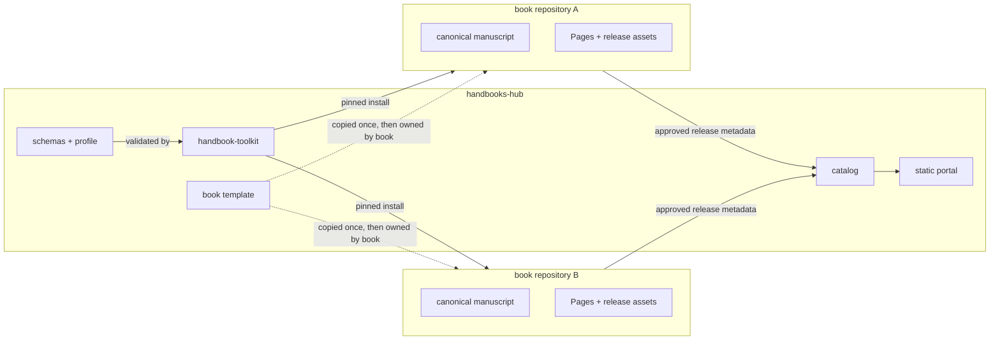

# Architecture

## Context

The platform separates **content ownership** from **shared machinery**:



The hub does not read a book's working tree. It consumes the release metadata that a book publishes
after owner approval. A book does not import hub source code; it installs the pinned toolkit package.

## Components

| Component | Responsibility | Must not do |
| --- | --- | --- |
| Book repository | Own canonical manuscript, book-specific tests, editorial history, release artifacts | Copy shared validators, depend on a parent checkout, publish unapproved content |
| `handbook-toolkit` | Parse and validate book descriptors, profiles, catalog entries and manuscript structure; build the portal; verify artifacts | Contain book-specific prose or hidden network calls |
| Profile | Declare required editorial elements, labels, placements and exceptions | Encode one book's topic or voice |
| Template | Provide a minimal, working starting point for a new book repository | Become a second copy of the toolkit |
| Catalog | List approved books and immutable release pointers | Link to branches, drafts or unverified builds |
| Portal | Render a static, categorized discovery site from the catalog | Host canonical content or mutate release assets |

## Dependency direction

```text
book content ──> pinned handbook-toolkit ──> shared schemas/profile version
      │
      └──> release manifest + checksums ──> catalog ──> portal
```

Rules:

1. The hub never depends on a book repository at build time.
2. A book depends on exactly one published toolkit version, recorded in its `book.yaml`.
3. A profile version is referenced explicitly; a toolkit upgrade never silently changes a book's
   editorial contract.
4. The catalog schema is the only interface between books and the portal.
5. The reference handbook is not a dependency. It was inspected read-only and is never imported.

## Repository layout

| Path | Owner | Notes |
| --- | --- | --- |
| `docs/` | Hub | Contracts, decisions, plan and assumptions |
| `schemas/` | Hub | Versioned JSON Schema contracts |
| `profiles/` | Hub | Versioned editorial profiles |
| `tools/` | Hub | Python package, tests and fixtures |
| `template/` | Hub | Starting point; a book copies it once and then owns its copy |
| `catalog/` | Hub | Approved release entries only |
| `sdd/` | Hub | Change proposals, specs, tasks and evidence |

## Trust boundaries and failure modes

- **Untrusted input:** book descriptors, catalog entries and reading-order paths are data. Validators
  reject absolute paths, `..` traversal and paths outside the declared manuscript root.
- **Supply chain:** the toolkit is installed from a tagged release; dependencies are constrained.
  Books record the toolkit version they used.
- **Publication:** a release tag and asset checksums are verified before catalog listing. A failed
  verification blocks listing; it does not degrade to a warning.
- **Agent separation:** an implementer cannot self-review. The reviewer checks the exact commit and
  re-runs the commands rather than trusting the implementer's summary.

## What the scaffold deliberately does not contain

- A Quarto build pipeline or committed artifacts.
- GitHub repository metadata, Pages configuration or release workflows.
- Sample-book content or a migration of existing content.
- Tool-specific agent adapters.

These arrive in the phases described in [`implementation-plan.md`](implementation-plan.md).
