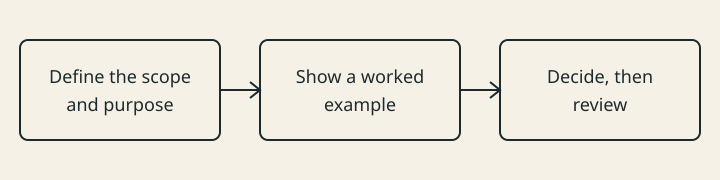

# 1. Example Chapter

This chapter is a replaceable template. It demonstrates the standard structure with a small,
vendor-neutral example. Replace the prose and identifiers when copying the template.

::: {.callout-note appearance="simple" icon=false title="When to Use This Chapter"}
- You are starting a new handbook from this template.
- You need a minimal chapter that passes the profile and build checks.
:::

::: {.callout-tip appearance="simple" icon=false title="Key Takeaway"}
A chapter is a reviewed decision record, not a collection of pages.
:::

## 1.1 Example Section

**Definition.** An example section is the smallest complete unit of a chapter.

**Purpose.** It shows the reader how the required structure works before they replace the content.

**What it includes.** A definition, purpose, scope, need, example, pitfall, trade-off and checklist.

**Why it is needed.** Without a complete example, authors copy an incomplete shape.

**Example.** An illustrative handbook names one reader, one outcome and one excluded subject.
@fig-section-structure shows how the section moves from scope to evidence and review.

{#fig-section-structure fig-alt="Three connected boxes: define scope and purpose; show a worked example; decide, then review." width="90%"}

::: {.callout-warning appearance="simple" icon=false title="Common Pitfall"}
Treating the template text as publishable content instead of replacing it.
:::

::: {.callout-important appearance="simple" icon=false title="Decision & Trade-off"}
How much template content should remain? Keep the structure; replace the subject matter.
:::

## 1.2 Worked Example — A Small Handbook

*In practice:* A team starts with this template, replaces the chapter title and section content, and
keeps the structure while reviewing the new material.

::: {.callout-important appearance="simple" icon=false title="Review Checklist — Example Chapter"}
- The chapter opens with When to Use This Chapter and Key Takeaway.
- The section has the required labels and closing elements.
- The worked example and review checklist are present.
:::

## 1.3 Further Reading

- The hub's `docs/editorial-contract.md` for the full profile.
